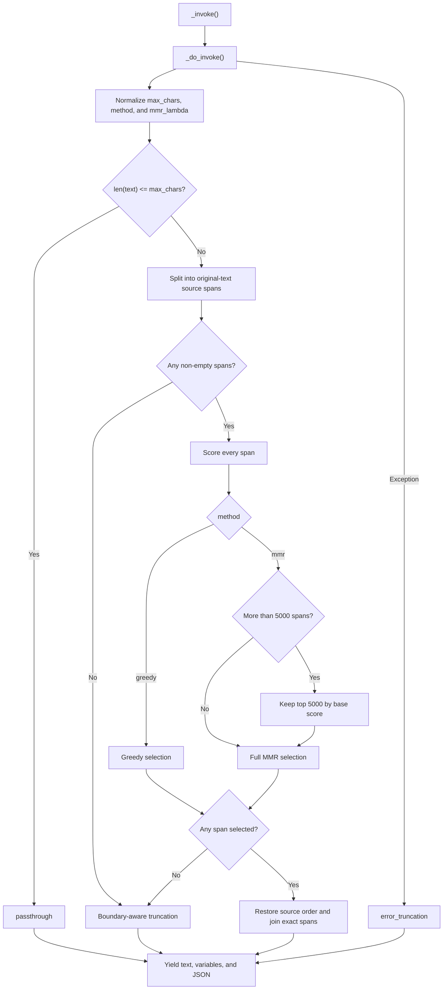

# Text Fitter Architecture

This document describes the implementation shipped with Text Fitter `0.0.2`.
The plugin is a stateless Dify tool: it accepts text and a character budget,
selects source spans from the input, and returns the selected text plus
metadata.

## Component map


The manifest declares the plugin and Python runner. The provider exposes an
unauthenticated tool because Text Fitter does not call an external service.
The tool schema declares `text`, `max_chars`, `method`, and `mmr_lambda`, along
with the structured output contract.

## Invocation pipeline



Passing input through is exact. For oversized input, selected source spans are
joined in their original order. Their original punctuation, inter-sentence
spaces, newlines, and closing quotes are retained.

## Sentence boundaries

`_split_sentences()` builds a same-length protected copy of the input, records
boundary offsets, and then slices the original text. The copy is used only to
prevent false boundaries; returned text never contains placeholder characters.

The splitter recognizes:

- CJK sentence endings such as `。！？`, with trailing ellipses and closing
  quote/bracket characters.
- English `. ! ?` sentence endings when followed by whitespace and an
  uppercase letter, digit, or CJK character.
- English closing quotes and brackets after sentence-ending punctuation.
- Physical line boundaries, including CRLF input.
- Common abbreviations such as `Dr.` and `Fig.`.
- Initialisms such as `U.S.` and `Ph.D.`.
- Personal initials such as `John F. Kennedy`.
- Decimal numbers such as `3.14`, which do not create a false boundary because
  the period is not followed by whitespace.

This is a deterministic heuristic, not a full language-model tokenizer.
English punctuation followed by a lowercase word is intentionally not treated
as a new sentence.

## Scoring

Each source span receives a relevance score:

```text
score = 0.3 * position + 0.5 * keyword_density + 0.2 * length
```

- Position favors the introduction and conclusion.
- Keyword density uses normalized TF-IDF over CJK characters and English
  alphanumeric words.
- Length penalizes very short filler and excessively long spans.

Tokenization is performed once per invocation. The same token lists are reused
by scoring and by the MMR overlap calculation.

## Selection

### Greedy

Greedy mode sorts spans by relevance and adds the highest-scoring spans that
fit the remaining character budget.

### MMR

MMR balances relevance against overlap with already-selected spans:

```text
MMR = lambda * relevance + (1 - lambda) * (1 - max_overlap)
```

`max_overlap` is updated incrementally against each newly selected span, so
the implementation avoids recomputing all pairwise overlaps.

For documents with more than 5000 sentence spans, only the top 5000 by base
score enter MMR. This bounds work for very large documents and is reported as
`mmr_prefilter`.

## Fallback behavior

If no complete source span fits the budget, `_boundary_aware_truncate()` tries:

1. The last sentence-ending punctuation in the budget.
2. The last whitespace boundary in the budget.
3. A hard cut with `...` or `……`.

The fallback can cut inside a sentence. It exists to preserve the primary
context-window guarantee when no complete span is viable.

If processing raises an exception, `_invoke()` logs the traceback to stderr and
returns a safe `error_truncation` result. It does not return oversized text,
duplicate JSON messages, or expose the traceback as workflow output.

## Outputs

Every successful invocation emits:

- `text`
- `original_char_count`
- `processed_char_count`
- `compression_ratio`
- `was_trimmed`
- `algorithm`
- One JSON object containing the same fields

The `algorithm` value is one of:

| Value | Meaning |
| --- | --- |
| `passthrough` | Input already fits the budget. |
| `greedy` | Greedy source-span selection. |
| `mmr` | Full MMR selection. |
| `mmr_prefilter` | Score prefilter followed by MMR. |
| `boundary_truncation` | No complete span fit; boundary-aware cut. |
| `error_truncation` | Internal error handled by a safe cut. |

## Performance and guarantees

- Output length is always at most `max_chars` for normalized positive limits.
- Selection preserves source order and does not paraphrase.
- Greedy dominates the normal path at approximately `O(n log n)` after scoring.
- MMR is approximately `O(k * n)` for `n` candidates and `k` selected spans,
  with the 5000-candidate cap bounding oversized documents.
- Working memory is proportional to the number and token count of spans.

## Source of truth

Implementation:

- [`tools/smart_trim.py`](../tools/smart_trim.py)
- [`tools/smart_trim.yaml`](../tools/smart_trim.yaml)

Regression tests:

- [`tests/test_smart_trim.py`](../tests/test_smart_trim.py)

Fuzz target:

- [`tests/fuzz_smart_trim.py`](../tests/fuzz_smart_trim.py) -- Atheris harness
  that attacks the output contract ("never more than `max_chars`, on every
  path") with random input. Runs in CI on ubuntu-latest; Atheris ships
  Linux-only wheels.
